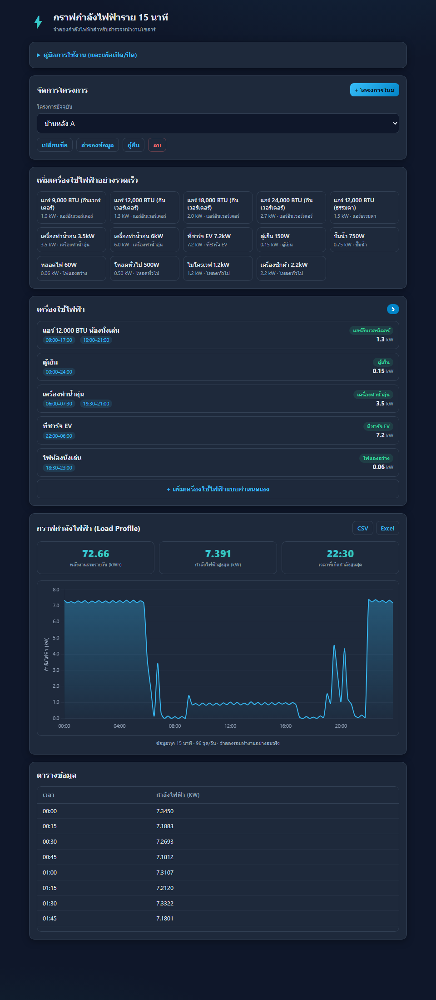
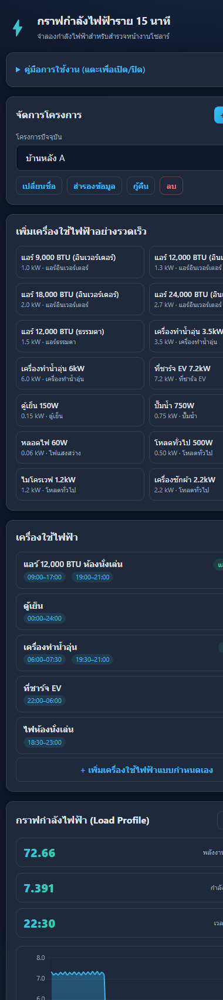

# เครื่องมือสร้างกราฟกำลังไฟฟ้า (Load Profile Generator & Simulation Tool)

เครื่องมือเว็บสำหรับสำรวจหน้างานติดตั้งระบบโซลาร์ ใช้จำลองกำลังไฟฟ้าที่ใช้จริงในบ้านหรืออาคาร
เป็นข้อมูลราย **15 นาที** (96 จุด/วัน) พร้อมกราฟสรุปและส่งออกเป็นไฟล์ CSV / Excel
เพื่อนำไปใช้ในแบบจำลองขนาดของระบบโซลาร์ (Solar Sizing)

> ### 🔗 ใช้งานออนไลน์ — ไม่ต้องติดตั้งอะไร
> **https://icem79ai-ops.github.io/solar-load-profile-generator/**
>
> ใครมีลิงก์ก็เปิดใช้ได้ทันทีบนเบราว์เซอร์ (มือถือ/แท็บเล็ต/คอม)
> การเปิดให้ใช้ผ่านเว็บ **ไม่ได้** ให้สิทธิ์คัดลอกโค้ด — ดู [`LICENSE`](LICENSE)



---

## เริ่มต้นใช้งาน

1. เปิดไฟล์ `index.html` ด้วยเว็บเบราว์เซอร์ (Chrome / Edge / Safari บนมือถือได้)
   - **ตั้งแต่เวอร์ชันนี้ ไม่ต้องต่ออินเทอร์เน็ตแล้ว** — ไลบรารีกราฟและส่งออกไฟล์ถูกเก็บไว้ในโฟลเดอร์ `lib/` แล้ว เปิดแบบออฟไลน์ได้ 100%
2. ข้อมูลทั้งหมดถูกบันทึกไว้ในเครื่องเบราว์เซอร์ (localStorage) — ปิดแล้วเปิดใหม่ข้อมูลยังอยู่



> **เคล็ดลับสายสวย** — สูตรการปรับกราฟ Chart.js ให้ได้หน้าตาแบบนี้ (gradient ฟ้า, เคิร์ฟโค้ง, tooltip ธีมมืด)
> ดูได้ในไฟล์ [`CHART_STYLE_SPEC.md`](CHART_STYLE_SPEC.md) — ใช้บอก AI agent ได้เลย

---

## ติดตั้งที่ทำงาน (วิธีโอนย้ายไปใช้)

### ก่อนโอน (ทำครั้งเดียวที่เครื่องนี้)
1. กดปุ่ม **สำรองข้อมูล** ในหน้าเว็บ เพื่อดาวน์โหลดไฟล์สำรองข้อมูลปัจจุบันเก็บไว้ (ย้ายข้อมูลที่ใส่ไว้ก่อนหน้าไปด้วย)
2. คัดลอกทั้งโฟลเดอร์ `load-profile-generator` (รวมโฟลเดอร์ `lib/`) ไปยังเครื่องที่ทำงาน
   - ผ่านแฟลชไดรฟ์ / OneDrive / ผู้ส่งผ่านไลน์-เมล (ซิปไฟล์ก่อนก็ได้ ลองดูไฟล์ `load-profile-generator.zip`)

### ที่เครื่องทำงาน (ไม่มีขั้นตอนการติดตั้งซอฟต์แวร์ใด ๆ)
**วิธีที่ 1 — ง่ายที่สุด (แนะนำ)**
- ดับเบิลคลิกไฟล์ `index.html` เพื่อเปิดใช้งาน → ใช้ได้ทันที
- ขั้นตอนแรกแนะนำให้กด **สำรองข้อมูล** เก็บไว้ในเครื่องทำงาน, หากต้องการย้ายข้อมูลเดิมมาให้กด **กู้คืน** แล้วเลือกไฟล์ `.json` ที่โอนมา

**วิธีที่ 2 — ถ้าวิธีที่ 1 เปิดแล้วใช้ไม่ได้ (บางเครื่อง/นโยบายความปลอดภัย)**
- รันเซิร์ฟเวอร์ขนาดเล็กในโฟลเดอร์นี้ ด้วยคำสั่งต่อไปนี้ใน Command Prompt / PowerShell:
  ```
  cd path/to/load-profile-generator
  python -m http.server 8000
  ```
- แล้วเปิดเบราว์เซอร์ไปที่ `http://localhost:8000`

### สร้าง Shortcut ติดไอคอนบนเดสก์ท็อป (ทำครั้งเดียว)
- คลิกขวาที่ไฟล์ `index.html` → **สร้างทางลัด** (Send to > Desktop) แล้วเปลี่ยนชื่อเป็น "เครื่องมือกราฟกำลังไฟฟ้า"
- ดับเบิลคลิกไอคอนเพื่อเปิดใช้งานทุกวัน

### หมายเหตุการใช้งานที่ทำงาน
- ข้อมูลถูกเก็บอยู่ในเบราว์เซอร์ของ **เครื่องเดียว** คือเครื่องที่คุณเปิดใช้ — ถ้าเปิดเครื่องอื่นจะไม่เจอข้อมูล (ใช้ปุ่มสำรอง/กู้คืนเพื่อย้าย)
- แนะนำสำรองข้อมูลเป็นระยะ ๆ (ทุกสิ้นวัน หรือก่อนปิดเครื่อง) เผื่อเครื่องมีปัญหา
- อัปเดตเวอร์ชันใหม่: คัดลอกโฟลเดอร์ใหม่ทับของเดิมที่เครื่องทำงาน แล้วใช้ปุ่ม **กู้คืน** เพื่อนำข้อมูลกลับ

---

## ขั้นตอนการใช้งาน

### 1. จัดการโครงการ
- กด **+ โครงการใหม่** เพื่อสร้างโครงการหนึ่งต่อหนึ่งไซต์งาน เช่น "บ้านหลังที่ 1"
- เลือกโครงการจากกล่อง **โครงการปัจจุบัน** เพื่อสลับระหว่างไซต์งาน
- ปุ่ม **เปลี่ยนชื่อ** / **ลบ** สำหรับจัดการโครงการ

### 2. เพิ่มเครื่องใช้ไฟฟ้า
มี 2 วิธี:

**วิธีที่ 1 — ปุ่มเพิ่มด่วน (Quick-Add)**
แตะปุ่มเครื่องใช้ไฟฟ้าที่มีอยู่ เช่น
- แอร์อินเวอร์เตอร์ 9,000–24,000 BTU (รวมแอร์แบบธรรมดา)
- เครื่องทำน้ำอุ่น 3.5kW / 6kW
- ที่ชาร์จ EV 7.2kW
- ตู้เย็น / ปั๊มน้ำ / หลอดไฟ / โหลดทั่วไป / ไมโครเวฟ / เครื่องซักผ้า

ระบบจะเพิ่มเครื่องนั้น ๆ เข้าโครงการทันทีและเปิดหน้าต่างให้ปรับรายละเอียดเพิ่มเติม

**วิธีที่ 2 — เพิ่มแบบกำหนดเอง**
กด **+ เพิ่มเครื่องใช้ไฟฟ้าแบบกำหนดเอง** แล้วกรอกข้อมูลเองทั้งหมด

### 3. ตั้งค่ารายละเอียดเครื่องใช้ไฟฟ้า
ในหน้าต่างแก้ไขเครื่องใช้ไฟฟ้า ระบุ:

| หัวข้อ | คำอธิบาย |
|---|---|
| ชื่อเครื่องใช้ไฟฟ้า | เช่น "แอร์ห้องนั่งเล่น" |
| กำลังไฟฟ้า (วัตต์) | กำลังไฟสูงสุดของเครื่อง (ดูจากป้ายฉลากเบอร์ 5 หรือแคตตาล็อก) |
| จำนวน | จำนวนเครื่องเดียวกันในบ้าน |
| ประเภทการทำงาน | กำหนดว่าระบบจะจำลองพฤติกรรมแบบใด (แอร์อินเวอร์เตอร์ / แอร์ธรรมดา / เครื่องทำน้ำอุ่น ฯลฯ) |
| สัดส่วนรอบทำงาน (Duty Cycle 0-1) | ค่า 1 = เปิดต่อเนื่องตลอดช่วง ค่า 0.4 = ทำงานจริงประมาณ 40% ของช่วงเวลา |
| ตัวคูณกำลังตอนสตาร์ท | กำลังกระชากตอนสตาร์ท เช่น แอร์ธรรมดากระชาก 2–3 เท่า |
| ระยะเวลาช่วงสตาร์ท / ช่วงลดกำลัง | นาทีของช่วงกระชากและการค่อย ๆ ลดกำลังของคอมเพรสเซอร์ |
| ช่วงเวลาการใช้งาน | กำหนดช่วงเวลาเริ่ม–สิ้นสุด หลายช่วงได้ใน 1 วัน (รองรับช่วงข้ามเที่ยงคืน เช่น 22:00–06:00) |

### 4. อ่านผลจำลอง (Load Profile)
- กราฟเส้นแสดงกำลังไฟฟ้า (kW) ราย 15 นาที ตลอด 24 ชั่วโมง
- กราฟจะอัปเดตทันทีเมื่อกดบันทึก หรือระหว่างพิมพ์ในหน้าต่างแก้ไข (แสดงผลแบบเรียลไทม์)
- ค่าสรุป 3 ค่า: **พลังงานรวมรายวัน (kWh)** · **กำลังไฟฟ้าสูงสุด (kW)** · **เวลาที่เกิดกำลังสูงสุด**
- ระบบจำลองรอบทำงานของคอมเพรสเซอร์ (duty cycle) ให้ค่าไม่เป็นเส้นตรงเหมือนของจริง

### 5. ส่งออกข้อมูล
- กดปุ่ม **CSV** หรือ **Excel** ที่มุมขวาบนของหัวข้อ "กราฟกำลังไฟฟ้า"
- ไฟล์มี 2 คอลัมน์: `Timestamp` (รูปแบบ `YYYY-MM-DD HH:mm`) และ `Power (kW)` จำนวน 96 แถวต่อวัน
- พร้อมนำไปวาง (copy-paste) ในแบบจำลองขนาดโซลาร์ใน Excel ได้ทันที

---

## หลักการจำลอง (Simulation Logic)

ระบบคำนวณกำลังไฟฟ้าความละเอียด **1 นาที** แล้วเฉลี่ยเป็นช่วง 15 นาที จึงได้ค่าที่ใกล้เคียงความเป็นจริง

- **แอร์อินเวอร์เตอร์**: สตาร์ทกระชาก → ค่อย ๆ ลดกำลังลงเมื่อถึงอุณหภูมิที่ตั้งไว้ (modulation) แล้ววิ่งที่กำลังต่ำต่อเนื่อง
- **แอร์ธรรมดา (Fixed)**: สตาร์ทกระชากสูง → ทำงานเต็มกำลังช่วงทำความเย็น → เปิด-ปิดรอบทำงานตาม Duty Cycle
- **เครื่องทำน้ำอุ่น**: เปิด-ปิดตามฮีตเตอร์ (thermostat)
- **ที่ชาร์จ EV**: ดึงกำลังคงที่ตลอดช่วงชาร์จ
- **ตู้เย็น**: ทำงานทั้งวัน เปิด-ปิดรอบสั้น ๆ พร้อมกระแสกระชากตอนคอมเพรสเซอร์เริ่มหมุน
- **ปั๊มน้ำ**: ทำงานเป็นพัก ๆ สั้น ๆ หลายรอบ
- **ไฟ / โหลดทั่วไป**: ต่อเนื่องคงที่

---

## ไฟล์ในโปรเจกต์

- `index.html` — โครงสร้างหน้าเว็บ (รวมคู่มือสั้นในหน้า)
- `style.css` — รูปแบบและสไตล์ (รองรับมือถือ)
- `app.js` — ตรรกะทั้งหมดของแอป (โปรเจกต์, จำลอง, กราฟ, ส่งออก, สำรอง-กู้คืน)
- `lib/chart.umd.min.js` — ไลบรารีกราฟ (Chart.js) อยู่ในเครื่อง
- `lib/xlsx.full.min.js` — ไลบรารีส่งออก Excel (SheetJS) อยู่ในเครื่อง
- `docs/screenshot-desktop.png` / `docs/screenshot-mobile.png` — ภาพหน้าจอสำหรับเอกสารนี้
- `CHART_STYLE_SPEC.md` — สูตรการปรับกราฟสไตล์นี้ (ใช้บอก AI agent ได้)
- `BUILD_PROMPT_TEMPLATE.md` — แม่แบบ prompt สำหรับให้ AI สร้างแอปแบบนี้ตัวใหม่
- `LICENSE` — สัญญาอนุญาตใช้งาน (สงวนลิขสิทธิ์)
- `THIRD-PARTY-NOTICES.md` — แจ้งลิขสิทธิ์ไลบรารีบุคคลที่สาม
- `licenses/` — สำเนาสัญญาอนุญาตฉบับเต็ม (Chart.js MIT, SheetJS Apache-2.0)

---

## ลิขสิทธิ์ (Copyright)

ลิขสิทธิ์ © 2569 (2026) **icem79ai-ops** — สงวนลิขสิทธิ์

| อนุญาต | ห้าม |
|---|---|
| เปิดใช้งานผ่านเว็บสำหรับผู้ที่ได้รับลิงก์ | คัดลอก ทำซ้ำ หรือเผยแพร่ซอร์สโค้ด |
| ใช้ในงานของตนเอง / งานส่วนตัว | ดัดแปลง แก้ไข หรือสร้างงานดัดแปลง |
| | จำหน่าย ให้เช่า หรือใช้บนผลิตภัณฑ์/บริการที่เรียกเก็บเงิน |
| | ลบหรือปกปิดข้อความลิขสิทธิ์ |

- โค้ดของโครงการ: [`LICENSE`](LICENSE)
- ไลบรารีบุคคลที่สาม: [`THIRD-PARTY-NOTICES.md`](THIRD-PARTY-NOTICES.md)
  — Chart.js v4.4.1 (MIT), SheetJS v0.18.5 (Apache-2.0)
- ลิขสิทธิ์เกิดขึ้นโดยอัตโนมัติเมื่อสร้างงาน ตามพระราชบัญญัติลิขสิทธิ์ พ.ศ. 2537
  ไม่ต้องจดทะเบียน (การจดแจ้งข้อมูลลิขสิทธิ์กับกรมทรัพย์สินทางปัญญาเป็นเพียงหลักฐานประกอบ)

**ข้อจำกัดทางเทคนิคที่ควรรู้:** แอปนี้ทำงานฝั่งเบราว์เซอร์ทั้งหมด (static site)
ดังนั้นผู้ที่เปิดหน้าเว็บย่อมสามารถอ่านไฟล์ JavaScript ที่ส่งไปให้เบราว์เซอร์ได้
ลิขสิทธิ์จึงคุ้มครองได้ทางกฎหมาย แต่ไม่ได้ซ่อนโค้ด — หากต้องการป้องกันเชิงเทคนิค
ต้องย้ายตรรกะการคำนวณไปทำงานฝั่งเซิร์ฟเวอร์ (เช่น Cloudflare Worker)

---

## หมายเหตุ

- ไม่ต้องติดตั้งซอฟต์แวร์ใด ๆ — เป็นไฟล์เว็บล้วน เปิด `index.html` ได้เลย
- **ทำงานแบบออฟไลน์ 100%** — โฟลเดอร์ `lib/` มีไลบรารีครบ ไม่ต้องต่ออินเทอร์เน็ต
- ข้อมูลเก็บเฉพาะในเครื่องเบราว์เซอร์ ไม่มีข้อมูลใดส่งขึ้นอินเทอร์เน็ต
- แหล่งที่มา (GitHub): <https://github.com/icem79ai-ops/solar-load-profile-generator>
- เว็บที่ให้บริการ: <https://icem79ai-ops.github.io/solar-load-profile-generator/>